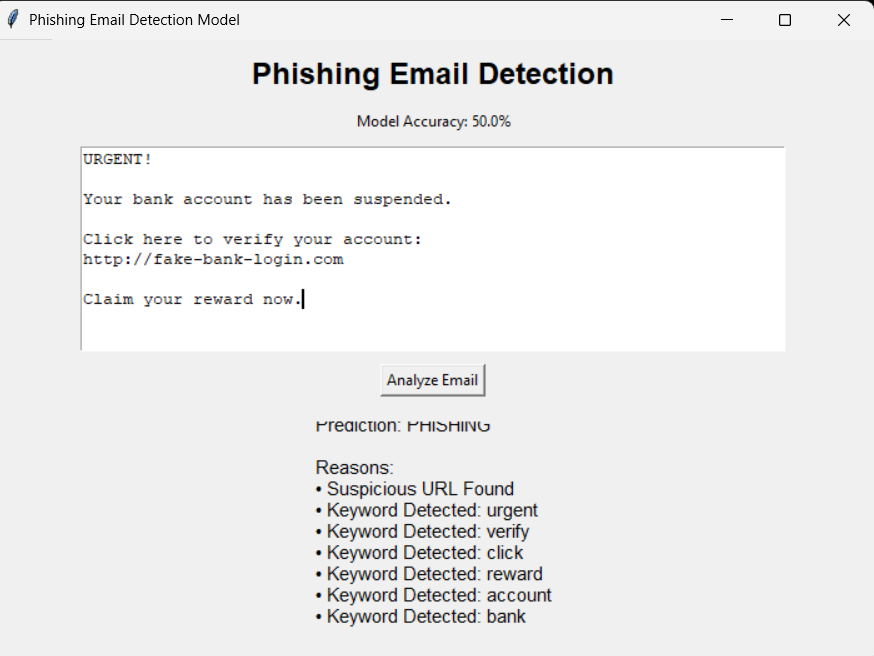

# 🛡️ Phishing Email Detection

A Python desktop application that classifies pasted email text as **phishing** or **safe** using TF-IDF text features and a Multinomial Naive Bayes model. It also flags selected urgency/credential-related keywords and URLs for manual review.

> **Educational prototype:** the repository contains only a very small illustrative dataset. Its metrics are based on a tiny holdout set and are not reliable estimates of real-world performance. Do not use this model as the sole basis for security decisions.

## ✨ Features

- Text classification with TF-IDF + Multinomial Naive Bayes
- Displays holdout accuracy, precision, recall, and F1 for transparency
- Input validation and helpful errors if the dataset is missing or malformed
- URL and selected suspicious-keyword review flags
- Shows the model's estimated phishing probability (not a certainty)
- Clear/reset action and a readable Tkinter interface
- Local processing: email content is not uploaded or stored by the app

## 🧰 Built With

- Python 3.10+
- pandas
- scikit-learn
- Tkinter (usually included with Python on Windows)

## 🖼️ Application Preview



## 📁 Project Structure

```text
Phishing-Email-Detection/
├── emails.csv                 # Small example dataset (text,label)
├── phishing_detector.py       # Model training and GUI
├── requirements.txt            # Python dependencies
├── result.png                  # Application screenshot
├── README.md
├── LICENSE
└── .gitignore
```

## 🚀 Installation and Run

1. Install Python 3.10 or newer.
2. Clone the repository:

   ```powershell
   git clone https://github.com/shivarjunchaturvedi/Phishing-Email-Detection.git
   cd Phishing-Email-Detection
   ```

3. Install dependencies:

   ```powershell
   python -m pip install -r requirements.txt
   ```

4. Start the app:

   ```powershell
   python phishing_detector.py
   ```

On Windows, `py phishing_detector.py` is also an option.

## 🧠 How It Works

1. Loads the `text,label` columns from `emails.csv`.
2. Splits data into stratified training and holdout sets.
3. Learns TF-IDF vocabulary only from the training set, then trains Multinomial Naive Bayes.
4. Prints holdout evaluation metrics to the terminal.
5. Uses the trained model to classify pasted email text and presents additional keyword/URL review flags.

## ⚠️ Important Limitations

- The bundled dataset contains only 10 short examples; a tiny test split makes performance scores highly unstable and unsuitable for meaningful claims.
- The model may miss modern phishing and may incorrectly flag legitimate messages.
- A URL or keyword is not proof of phishing; legitimate emails can contain both.
- The displayed probability is model-estimated and not a calibrated real-world risk probability.
- Do not paste confidential email content into any application unless you understand its data handling. This app processes the supplied text locally and does not make network requests.

For meaningful evaluation, use a larger, diverse, correctly labelled dataset; separate training and test data by source/time where possible; measure false negatives and false positives; and check for duplicate or near-duplicate messages between splits.

## 🔐 Safe Use

Treat predictions as triage hints, not definitive verdicts. Verify the sender address, link destination, and requests for credentials or payment through a trusted channel.

## 👨‍💻 Author

**Shivarjun Chaturvedi**

- GitHub: [@shivarjunchaturvedi](https://github.com/shivarjunchaturvedi)
- LinkedIn: [Shivarjun Chaturvedi](https://www.linkedin.com/in/shivarjun-chaturvedi)
